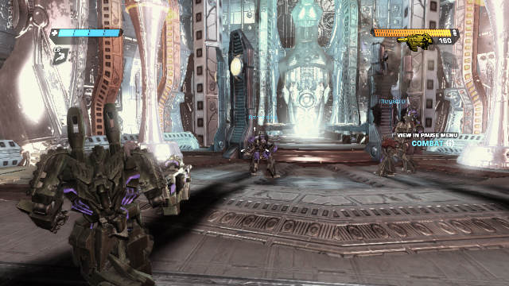
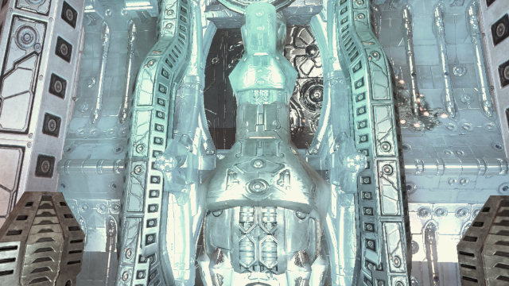

# Transformers: War for Cybertron for Nintendo Switch

> **This port is being developed entirely with the help of ChatGPT 6.2 Sol Extra High.**

An experimental Nintendo Switch port of the Xbox 360 version of *Transformers: War for Cybertron*, built through static recompilation with ReXGlue. The game is also brought up on PC to help debug the port. You must provide your own copy of the game; this repository does not include game files, generated game code, or a prebuilt NRO.

## Current status

**The game is playable on Switch, but there is still plenty to fix.** In [build-56](docs/builds.md#build-56--start-a-fresh-depth-map-when-the-shadow-atlas-is-reused), I made it into the campaign and progressed through several scenes. Shadows are now visible, but the lighting still looks flat and many effects are missing. There are also occasional startup crashes and other visual and gameplay issues. I haven't tested the entire game yet.

The Switch renderer uses deko3D and a locally compiled shader pack. Some shaders are still missing from that pack, so you should expect objects or parts of scenes to disappear until those shaders are captured and compiled. The Windows build has also reached the [first Decepticon mission](docs/builds.md#build-22--register-the-decepticon-campaign-callback).

I currently test on an overclocked Switch at **CPU 2397 MHz, GPU 768 MHz, and RAM 2500 MHz**. In an earlier [build-55](docs/builds.md#build-55--apply-shadow-atlas-clears-to-the-equivalent-physical-pitch) session at those clocks, the profiler recorded about **28.5 FPS on average** over 21 ten-second intervals. That session included startup and time spent inspecting a scene, so it is not a gameplay-only benchmark. In my testing, performance is currently CPU-limited. These settings describe my test configuration, not a validated performance target or requirement.

## Future plans

For now, I want to improve the rendering: bring the lighting closer to the original, restore missing effects, and work through the other visual problems. Once the game looks better, I'll focus on reducing CPU load and improving performance.

## Switch screenshots

Captured during hardware testing of build-56 (local attempt 60):





## Development documentation

The development history, experiments, results, and outstanding issues are documented in the repository:

- [Build history](docs/builds.md) records each build, changes, checks, and reported hardware results.
- [UE3 Xbox 360 porting research](UE3_Xbox360_Switch_References.md), [early Switch research](docs/early-switch-research.md), and the [reference index](reference-docs/README.md) collect research and related ports, including findings useful to other projects.

## Building the port

The following instructions are for an experimental development build. Game content, generated files, shader captures, and build outputs stay on your machine.

## PC build

Use your own uncompressed Xbox 360 disc image or an extracted game directory containing `default.xex` and `TransGame/`. The bootstrap currently accepts one executable revision, Title ID `4156084C`, Media ID `02619995`, version `0.0.0.4`. See the [input fingerprints](UE3_Xbox360_Switch_References.md#war-for-cybertron-discs-and-packages).

On Windows x64 or Linux x64, install these prerequisites once.

- Python 3.11 or newer.
- The matching [ReXGlue SDK 0.10.0 release](https://github.com/rexglue/rexglue-sdk/releases/tag/v0.10.0). Unzip it into `out/deps/` so the CLI is at `out/deps/win-amd64/bin/rexglue.exe` or `out/deps/linux-amd64/bin/rexglue`. To use a different install directory, pass `--sdk PATH` or set `REXSDK` to the SDK prefix.
- For ISO input, [extract-xiso](https://github.com/XboxDev/extract-xiso/releases). Put the extractor on `PATH`, pass `--extract-xiso PATH`, or unzip the release into `out/deps/extract-xiso/` if the archive contains `artifacts/extract-xiso` or `artifacts/extract-xiso.exe`. Allow about 7 GB for the extracted game, plus space for generated C++ and compiler outputs.
- For native compilation, CMake 3.25+, Ninja, and Clang 20+. On Windows, use a Visual Studio Developer Command Prompt for the x64 C++ build tools and Windows SDK, with `clang++` on `PATH`. On Linux, make `clang++-20` available and install the SDK's host development dependencies. [ReXGlue build workflow](https://github.com/rexglue/rexglue-sdk/blob/v0.10.0/.github/workflows/_build-platform.yaml)

For an existing portable Windows toolchain, `build.cmd` can load an optional `out/deps/pc-env.cmd` to set its environment for that build. Keep the file local to the checkout.

Run the entry point for your system and enter the image path at the prompt. You can also supply the path as the first argument.

```bat
build.cmd "D:\Games\War for Cybertron.iso"
```

```sh
sh ./build.sh "/path/to/War for Cybertron.iso"
```

PC Debug is the default. Add `--codegen-only` to inspect the ReXGlue result without the compiler toolchain. Linux native execution still needs verification.

Use `build.cmd extracted --pc-config relwithdebinfo` to select the matching ReXGlue runtime and graphics plugin with symbols for Windows bring-up. This configuration passes the vertex-fetch assertion observed with the Debug plugin during frontend loading. See the [desktop comparison](docs/builds.md#build-0013--compare-the-desktop-launch-with-the-non-debug-graphics-module).

Each invocation writes a log under its sequential number, for example `out/attempts/23/build.log`. The script keeps generated source and compiler outputs under that attempt and caches extracted images by ISO SHA-256 under `out/game-data/`. Keep those folders local.

## PC launch

After a successful Windows build, run `run-pc.cmd`. It prints the number of the newest compiled build it can launch and warns if the build's recompilation fixes differ from the current workspace. It passes the game directory used by that build to ReXGlue and stores user data under `out/pc-user-data/`.

If Windows reports a missing debug CRT DLL, use the debug runtime from your Microsoft C++ and Windows SDK installation. For a portable toolchain, set `WFC_WINDOWS_DEBUG_RUNTIME_DIR` to the directory containing the x64 debug runtime DLLs before building. The Debug build copies the required DLLs next to the local executable. Keep these Microsoft Debug DLLs in your local build directory.

## Switch build

Install the host ReXGlue CLI and build tools listed above. Also install devkitA64, libnx, deko3d, UAM and switch-tools from [devkitPro](https://devkitpro.org/wiki/Getting_Started). Check out the [Horizon ReXGlue source](https://github.com/nx-mod/rexglue-sdk-nx/tree/f961303fe3c6e3a90905b379ff4bf3de9a35a757) at revision `f961303fe3c6e3a90905b379ff4bf3de9a35a757` and run `python tools/switch_setup.py` from the SDK root to prepare its dependencies and the Horizon FFmpeg configuration. Place the SDK in `out/deps/rexglue-sdk-nx/` or supply its location with `--switch-sdk PATH`. Set `DEVKITPRO` or pass `--devkitpro PATH`.

```bat
build.cmd extracted --target switch
```

```sh
sh ./build.sh extracted --target switch
```

Both entry points accept an ISO in place of `extracted`. A successful build writes `out/attempts/<number>/switch/wfc.nro`. The Switch target starts the recompiled title and connects Xenos command processing to deko3d. A local shader pack enables the geometry draws that use shaders from the capture.

For a hardware check, place the NRO at `sdmc:/switch/wfc/wfc.nro` and the supported extraction at `sdmc:/switch/wfc/game/`, with `default.xex` and the complete `TransGame/` directory directly inside `game/`. Start **Transformers: War for Cybertron** from the Homebrew Menu in application mode. A black screen may appear while startup runs. After the run, check `sdmc:/switch/wfc/logs/` for the attempt number, guest entry, first Direct3D calls and any errors. See [the build history](docs/builds.md) for the expected result of each build.

To prepare the shader pack, use the `logs/wfc-shaders-<number>.xsh` capture from your Switch run. Build the external `ds_hlsl` tool from the [pinned Gears of War 2 reference](https://github.com/VasilkovND/gears2-nx/tree/c202b045cce00c96b040b095eb8e5250c7c83b59) and provide its matching `shaders/XenosRecomp/shader_common.h` and DXC:

```text
python tools/wfc_shaders.py path/to/capture.xsh out/wfc-shaders.bin --translator path/to/ds_hlsl --common path/to/shader_common.h --dxc path/to/dxc
```

Repeat `--extra-capture path/to/another.xsh` to merge additional runs of the same executable revision. Place `out/wfc-shaders.bin` alongside `wfc.nro`. A fresh shader cache can increase startup time. Captures and shader packs contain data from your copy of the game, so keep them local.

## Development notes

- [Repository instructions](AGENTS.md)
- [Build history](docs/builds.md)
- [Terra's Xbox 360 UE3 porting research](UE3_Xbox360_Switch_References.md)

## License

The project's own source is licensed under [GPL-3.0-only](LICENSE). Third-party material retains its own terms; see [third-party notices](THIRD_PARTY_NOTICES.md). The original game and its assets are not covered by this license.

